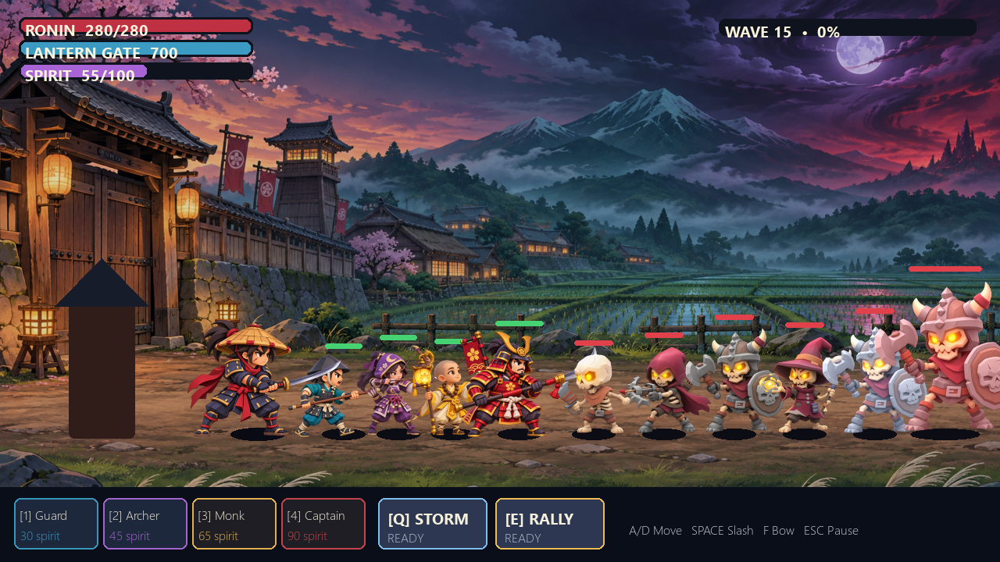

# Moonblade: Last Lantern

Moonblade is a defense game for Windows. You control a ronin, fight enemies, summon allies, and protect the village gate.



The game is inspired by *Samurai vs Zombies Defense*. That game is no longer available on modern stores, so this project tries to bring back the same kind of fun with new code and original art.

## What is playable

* 15 campaign waves with persistent progress and star ratings
* Endless Night mode after the main menu, with a saved personal record
* Story, Normal, and Nightmare difficulty settings
* controllable sword and bow combat
* four summonable allies, including the Gate Captain
* summon cooldowns and a regenerating spirit resource
* Storm and Rally active abilities
* six enemy roles, including Iron Revenants and recurring bosses
* achievements with career statistics and coin rewards
* five permanent upgrade paths
* automatic local saving
* mouse and keyboard support

## Controls

* Move with `A`, `D`, or the arrow keys
* Attack with the sword using `Space` or the left mouse button
* Fire the bow with `F`
* Summon allies with `1`, `2`, `3`, and `4`
* Cast Storm with `Q`
* Use Rally with `E`
* Pause or return with `Esc`

## Run from source

Install Python 3.11 or newer, then run:

```powershell
python -m pip install -r requirements.txt
python game.py
```

## Build the Windows application

Run `build.ps1` from PowerShell. It installs the two required packages when needed and creates `release/application.exe`.

```powershell
powershell -ExecutionPolicy Bypass -File .\build.ps1
```

The packaged game stores progress in `%LOCALAPPDATA%\MoonbladeDefense\save.json`.

## Project status

The game is still in development. It has a full campaign, upgrades, bosses, difficulty options, achievements, and an endless mode. More allies, maps, animation, controller support, music, and sound will come later.

## License

The source code is available under the MIT License. The painted battlefield image in `assets/` is included for use with this project; please do not redistribute it as a standalone asset pack.

Moonblade is not connected to Glu Mobile or Electronic Arts.
